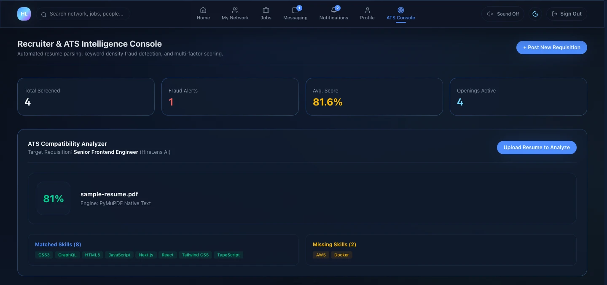
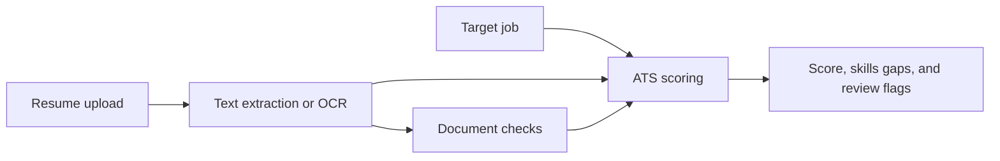

<div align="center">

# HireLens AI

**Resume screening and job matching for candidates and recruiters**

Compare a resume with a job description, see the skills behind the match score, and review potential document manipulation in one workspace.

[Quick start](#quick-start) · [Try the demos](#try-the-demos) · [How scoring works](#how-scoring-works) · [API reference](#api-reference)

`Next.js 16` · `React 19` · `FastAPI` · `Tesseract OCR` · `Apache-2.0`

</div>



## What you can do

| Workspace | Workflow |
| --- | --- |
| **Candidate** | Browse job openings, choose a target role, and scan a resume to see matched skills and gaps. |
| **Recruiter** | Publish openings with required skills, screen resumes against a requisition, and review results in the candidate pipeline. |
| **Document review** | Extract text from PDFs and DOCX files, use OCR for scans and images, and flag signals such as hidden PDF text or repeated keywords. |

## Quick start

Use **Python 3.13 or 3.14**, **Node.js 20.9+**, and npm. Install **Tesseract** and make it available on your `PATH` to analyze scanned PDFs or image uploads. A text-based PDF or DOCX works without it.

### Start the API

```bash
git clone https://github.com/harshvardhanmishra32/HireLens_AI.git
cd HireLens_AI
python3 -m venv .venv
source .venv/bin/activate
python -m pip install -r backend/requirements.txt

cd backend
python -m alembic upgrade head
python -m uvicorn main:app --reload
```

### Start the web app

From the repository root in a second terminal:

```bash
cd frontend
npm ci
npm run dev
```

| Service | Open locally |
| --- | --- |
| Web app | [localhost:3000](http://localhost:3000) |
| Demo sign-in | [localhost:3000/login](http://localhost:3000/login) |
| Interactive API docs | [localhost:8000/docs](http://localhost:8000/docs) |
| API health check | [localhost:8000/health](http://localhost:8000/health) |

<details>
<summary><strong>Configuration and database</strong></summary>

| Variable | Purpose |
| --- | --- |
| `NEXT_PUBLIC_API_URL` | Set in `frontend/.env.local` when the browser should use an API URL other than `http://localhost:8000`. |
| `DATABASE_URL` | Optional application database connection. Local development defaults to SQLite. |
| `SYNC_DATABASE_URL` | Optional synchronous connection for Alembic. Set it when the migration connection differs from the application connection. |
| `SECRET_KEY` | JWT signing key. Supply your own value outside local development. |
| `BACKEND_CORS_ORIGINS` | Comma-separated frontend origins for the API. |

The authentication database persists accounts. Job openings and candidate pipeline entries are stored in memory and reset when the API restarts.

</details>

## Try the demos

<details open>
<summary><strong>Candidate demo</strong></summary>

1. Open the local sign-in page and select **Candidate Demo**.
2. Go to **Jobs**, find an opening, and select **Target with ATS Scanner**.
3. Select **Upload Resume to Analyze** and upload a sample PDF, DOCX, PNG, or JPEG.
4. Review the match score, skills gaps, and any document flags. The analysis API also returns improvement suggestions.

</details>

<details>
<summary><strong>Recruiter demo</strong></summary>

1. Open the local sign-in page and select **Recruiter Demo**.
2. Go to **Jobs** and select **Target with ATS Scanner** on the opening you want to screen against.
3. Under **Screened Candidate Pipeline**, select **+ Screen Candidate** and upload a sample resume.
4. Review the candidate’s score, placement, and any document flags in the pipeline.

</details>

## How scoring works



<details>
<summary><strong>Scoring breakdown and review signals</strong></summary>

| Signal | Weight | How it’s calculated |
| --- | ---: | --- |
| Skills coverage | 50% | Exact and fuzzy matches against the role’s skills |
| Text similarity | 20% | TF-IDF cosine similarity between resume and role text, adjusted by skills coverage |
| Experience | 15% | Estimated experience relative to the role’s target |
| Formatting | 15% | Coverage of recognized resume sections |

Hidden or very small PDF text and keyword stuffing can reduce the score. Review the underlying signals in context before drawing conclusions about a candidate.

</details>

## API reference

The [interactive Swagger UI](http://localhost:8000/docs) lets you try requests against your local API. Resume uploads use multipart form data. The API sets a 15 MiB limit per file.

| Method | Endpoint | Purpose |
| --- | --- | --- |
| `GET` | `/health` | Check API availability |
| `GET` / `POST` | `/api/v1/jobs` | List or create openings |
| `POST` | `/api/v1/resumes/analyze` | Return a score, skills, document flags, and suggestions |
| `POST` | `/api/v1/resumes/screen` | Evaluate a resume for a requisition and add a pipeline entry |
| `GET` | `/api/v1/resumes/pipeline` | List candidate pipeline entries |

<details>
<summary><strong>Run a sample API request</strong></summary>

```bash
curl --fail-with-body http://localhost:8000/api/v1/resumes/analyze \
  -F 'file=@-;filename=sample-resume.txt;type=text/plain' \
  -F 'job_title=Frontend Engineer' \
  -F 'job_description=Build accessible React applications with TypeScript.' <<'EOF'
Jordan Patel
Professional Summary
Frontend engineer building accessible web applications.
Skills
React, TypeScript, JavaScript, HTML, CSS
Experience
Built a React component library and improved keyboard navigation.
EOF
```

</details>

## Project layout

| Path | Contents |
| --- | --- |
| [`frontend/app/`](frontend/app/) | Landing page, authentication screens, and dashboard |
| [`frontend/lib/api.ts`](frontend/lib/api.ts) | Frontend API client |
| [`backend/app/api/endpoints/`](backend/app/api/endpoints/) | Authentication, job, and resume endpoints |
| [`backend/app/services/`](backend/app/services/) | Resume parsing, OCR, scoring, and user services |
| [`backend/alembic/`](backend/alembic/) | Database migrations |
| [`backend/tests/`](backend/tests/) | Authentication and resume-screening tests |

Run the backend test suite from the repository root with the virtual environment active:

```bash
cd backend
python -m pytest
```

## License

[Apache License 2.0](https://github.com/harshvardhanmishra32/HireLens_AI/blob/main/LICENSE).
